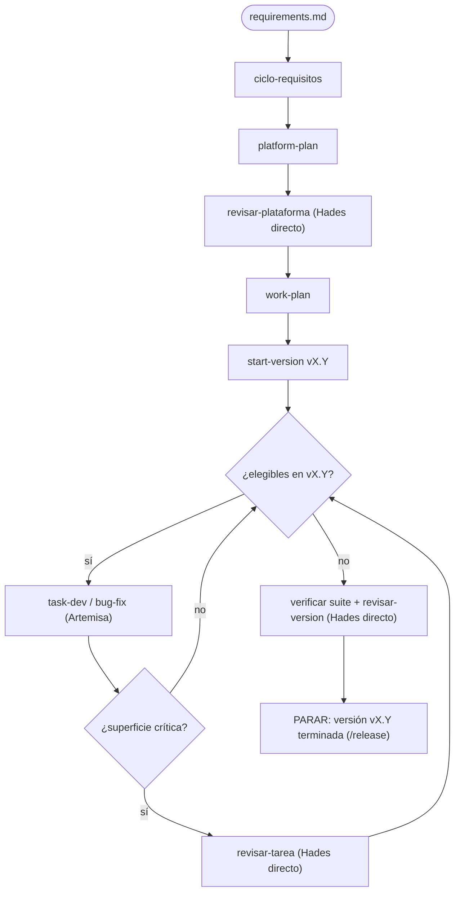

# Orquestación Adevv

Vista general del motor ligero de orquestación (`skills/orquestar/orquestar.py`).

## 1. Principios del motor

1. **Estado puro desde disco (`estado`)**: deduce el siguiente paso inspeccionando `docs/requirements/`, el backlog en `docs/plan/`, la rama `release/vX.Y` (o `hotfix/vX.Y.Z`) y los informes en `docs/review/`.
2. **Modelos, dificultad y reservas (`perfiles.py`)**: cada rol (`atenea`, `artemisa`, `hades`, `clio`, `cronos`) resuelve su arnés, modelo y esfuerzo según la `dificultad` (`sencilla` | `media` | `dificil`) o el `perfil` explícito de la ficha, probando `reserva` en orden ante cuota agotada, arnés ausente o acceso por suscripción deshabilitado.
3. **Revisiones directas sin agente secretario**: `revisar-plataforma`, `revisar-tarea` y `revisar-version` invocan directamente a Hades desde Python, sellan `Producto revisado: <huella>` y hacen commit directo. `revisar-tarea` solo se exige cuando el cambio toca superficies críticas (`adevv/`, `skills/`, `agents/`, `workflows/`, `pyproject.toml`, `orchestration.json`, `PROJECT.md`) o existe un informe previo rechazado.
4. **Caché de verificación por `huella_producto`**: `adevv orquestar --verificar "<cmd>"` y la suite de cierre de versión se indexan por la huella de los ficheros de producto (ignorando `docs/plan/` y `docs/review/`), evitando reejecutar la suite tras commits documentales.
5. **Tope corto y bloqueo limpio**: si un ítem acumula `--reintentos` intentos sin progreso (2 por defecto), pasa a `status: blocked` con diagnóstico claro en lugar de ciclar indefinidamente.
6. **Métricas append-only**: pasos, invocaciones a roles, verificaciones y eventos de cuota quedan registrados en `orquestar_metricas.jsonl` (`adevv metricas`, `adevv agentes`).

## 2. Flujo del bucle

