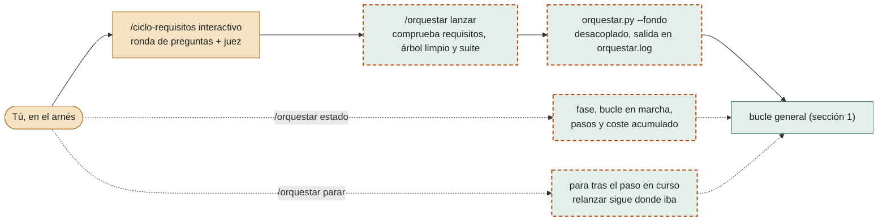
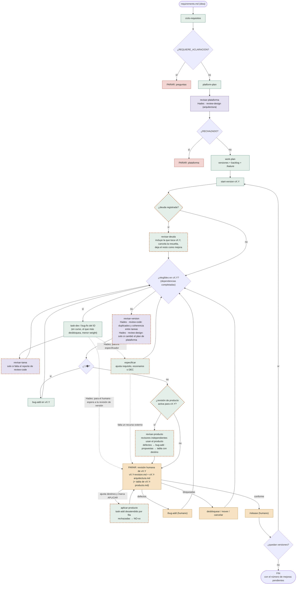
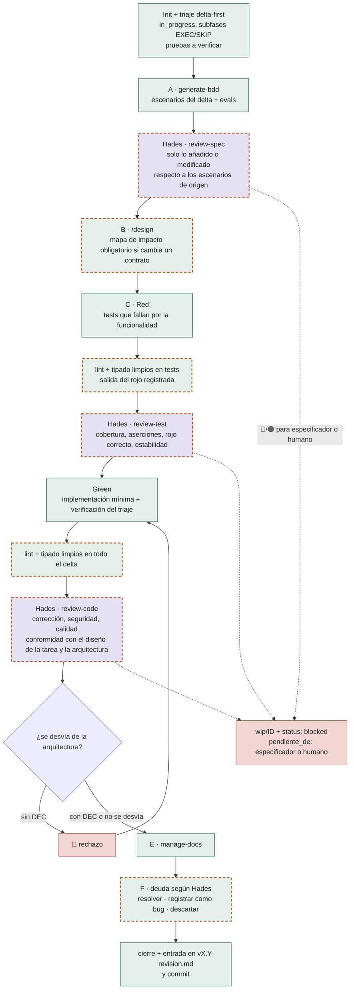

# Orquestación Adevv

Vista general del flujo. Las reglas viven en las skills; si algo no coincide, mandan ellas.

## 0. Arranque desde un arnés

La conversación se limita a los requisitos. Después, `/orquestar` lanza el bucle desatendido y vuelve; el bucle deduce la fase del disco y continúa desde donde toque.

## 1. Bucle general (`orquestar.py`)

`--harness` elige el arnés principal de cada paso. Si ese principal agota cuota o falla, las reservas explícitas usan su propio arnés, modelo y esfuerzo en el orden configurado. Un cambio de arnés inicia sesión nueva; una reserva del mismo arnés puede reanudar la sesión tras agotar cuota. Las métricas reflejan el perfil ejecutado. Si el arnés forzado difiere del principal configurado, no hereda su modelo ni esfuerzo incompatibles; las reservas heredan los campos no redefinidos del principal efectivo. `--cmd` conserva su plantilla explícita.

Cada caja es una ejecución del arnés. Los análisis sin progreso prueban niveles superiores, escalada y reservas con `--reintentos` intentos por perfil (2 por defecto), independientemente por paso y argumento. Al agotarlos, `especificar` y `revisar-tarea` bloquean solo el ID y continúan con las independientes; los análisis globales paran con diagnóstico de perfiles e intentos. Un `task-dev`/`bug-fix` sin progreso conserva su promoción y bloqueo local. Los pasos restantes paran tras agotar `--reintentos`. También se para por suite roja que agota su recuperación de cierre, fallo persistente de todos los perfiles del arnés, `--parar` o `--max-pasos`. Las tareas con alguna `depende_de` sin completar esperan. La recarga conserva perfiles y contadores parciales de análisis. Una tarea o bug puede fijar su propio `perfil` (arnés, modelo y esfuerzo, único o por rol) por encima del perfil por dificultad: si no está disponible se usan las reservas con un aviso, con `estricto: true` se espera la cuota o se bloquea la tarea, y un perfil inválido para el bucle con el error del backlog. Pasos, roles, esperas y verificaciones quedan en `orquestar_metricas.jsonl`.

El bucle observa el entregable del paso. En desarrollo cuentan los cambios de producto, incluso sin commit, el estado operativo de la ficha y los dictámenes formales del ID. En análisis cuenta el artefacto del paso. Confirmar un commit vacío o reformular el diagnóstico en la ficha y el resumen de versión deja intacto el presupuesto de intentos.

Si Hades agota los perfiles autorizados sin emitir dictamen, cada intento sin avance cuenta para ese paso e ID. Al alcanzar `--reintentos`, el bucle identifica la revisión pendiente y se detiene con el trabajo en su sitio. Una reserva puede aportar el dictamen en la misma invocación. Si queda cuota pendiente, el bucle aplica su espera. La recarga automática conserva los contadores técnicos. Un arranque manual concede otra tanda y conserva el árbol Git, las preguntas y las métricas. Incorporar una respuesta renueva los intentos técnicos de su ID.

Ante un error del arnés, desarrollo continúa al paso siguiente si la ficha está completada, hay un commit nuevo, el árbol está limpio y la aprobación canónica cubre el producto confirmado. El trabajo parcial se conserva durante la recuperación del arnés.

Hades incluye la línea `Producto revisado: <huella>` justo después del veredicto de código. La huella cubre los mandatos rastreados. El archivo temporal que la CLI retira al terminar queda fuera de la huella y sigue contando para la evidencia exacta de las pruebas.

Si una nota desplaza o elimina la huella, Git conserva la del informe que la emitió, incluso cuando el mismo commit cambia el producto. Restaurar una aprobación revocada mantiene la revisión pendiente aunque cambie la sangría, se quite la etiqueta de lenguaje de un ejemplo o se añadan notas de seguimiento. Cuando Hades reevalúa el mismo producto y conserva el texto anterior, identifica el último rechazo en la cabecera con `Rechazo reevaluado: <SHA completo del commit>`, justo después de `Producto revisado`. Una vez confirmada esa reevaluación en Git, una nota puede desplazar la referencia. Un rechazo posterior vuelve a dejar pendiente la revisión. Una aprobación de un producto distinto se contrasta con su propia huella.

Al confirmar cambios durante un paso de desarrollo, el bucle registra el último commit del intento para ese ID en las métricas. El selector y el preflight recuperan ese objetivo al relanzar, aunque el paso haya fallado después de marcar la ficha como completada. Un paso de otro ID conserva la aprobación anterior. Para informes históricos se consulta el commit que emitió el veredicto. Confirmar una copia de la aprobación histórica de A después de un rechazo de B mantiene pendiente la revisión de B. Una aprobación histórica con una comprobación propia de B permite continuar. Las citas y las notas de seguimiento conservan la acreditación original. Si la aprobación ha caducado, el selector pide `revisar-tarea`. Una reevaluación vigente cuenta como avance incluso en el último intento.

## 2. Dentro de una tarea (`task-dev` / `bug-fix` en modo orquestado)

Sin pausas para el humano: lo que se habría validado va a `vX.Y-revision.md`. Cada revisión se repite mientras Hades deje algo al desarrollador; lo que deja al especificador o al humano bloquea la tarea y el bucle sigue con el resto. Una desviación de la arquitectura se registra como `DEC` en el plan de plataforma; la revisa `review-design` en la revisión de versión.

## 3. Quién revisa qué

| Revisión | Cuándo | Mira | Nunca mira |
|---|---|---|---|
| `review-spec` | Cada tarea, antes del diseño | Solo lo que la tarea añade o modifica en escenarios y evals; trazabilidad que existe y corresponde | Diseño ni código |
| `review-design` | `revisar-plataforma` y `revisar-version` | Plan de plataforma y sus `DEC` | Código ni diseños por tarea |
| `review-test` | Cada tarea, tras el rojo | Cobertura, aserciones, rojo correcto, estabilidad y preparación de las pruebas | Código de producción |
| `review-code` | Cada tarea, tras el verde, y transversal en `revisar-version` | Corrección, seguridad, calidad, eficiencia, docs y conformidad con el diseño y la arquitectura (incluye build, CI y configuración) | Pruebas |
| `revisar-producto` | Al cerrar la versión, si está activa (`producto` en `orchestration.json`), o a mano | El producto en uso: utilidad, contenido, diseño, usabilidad y accesibilidad frente a recorridos y criterios de éxito | Código, arquitectura ni pruebas |

Lo determinista (lint, tipado, rojo de la suite) se ejecuta antes de llamar a Hades. Cada 🟡/🔵 lleva un destino: `resolver` (por defecto), `registrar` (bug de deuda sin versión, peso > 1000, con su origen) o `descartar`. `revisar-deuda`, al abrir cada versión, decide qué deuda entra.

## Recuperación de errores del arnés en pasos

Las marcas con hora real de reinicio conservan su plazo. Las respuestas sin hora y los errores de créditos generan marcas supuestas: el trabajo pendiente sirve de comprobación al relanzar y cada `cuota_reintento_s` segundos (300 por defecto, valor positivo finito en `orchestration.json`). Los errores de créditos avisan una vez por episodio; una respuesta satisfactoria o un reset permite avisar de nuevo si vuelven a faltar créditos.

`adevv orquestar --cuota-reset codex/m1` recupera un modelo; `--cuota-reset codex`, todo el arnés; `--cuota-reset`, todas las marcas. Se añaden eventos de recuperación sin borrar histórico ni tokens. Un bucle esperando cuota continúa en su siguiente comprobación, como máximo 30 segundos, y respeta `--parar`. Las consultas `--estado` y `--agentes` muestran la certeza (real/supuesto) y el origen de las marcas vigentes. El reset es una orden independiente que no arranca el bucle ni el gateway.

`adevv orquestar --reintentos-arnes 3` permite tres reintentos adicionales por perfil ante errores ajenos a cuota, con esperas de 60, 300 y 900 segundos. Para límites mayores se repite la espera de 900 segundos. El límite debe ser entero no negativo; cero pasa a la reserva sin esperar. Al agotarlo se prueba la siguiente reserva en orden y con sesión nueva. No consume pasos ni intentos por falta de progreso. Las esperas respetan `--parar`.

Cada ejecución conserva sus métricas. Solo se detiene por este error cuando se agotan todos los perfiles; consola y aviso incluyen los últimos 2000 caracteres de la salida del último arnés ejecutado. Un paso completado y commiteado no se repite por un retorno erróneo. La cuota mantiene su circuito, incluida su recuperación si otra reserva falla por red. Esta recuperación corresponde a pasos del bucle; no cambia el tratamiento de errores operacionales de los roles ni de la conversación del gateway.

### Acceso deshabilitado durante revisiones

`adevv orquestar --agente hades` prueba las reservas autorizadas y elegibles cuando Claude devuelve `Your organization has disabled Claude subscription access for Claude Code.`. Respeta el orden, las cuotas vigentes y el perfil estricto. Las métricas distinguen el fallo de acceso del dictamen emitido por la reserva; este fallo no inventa cuota. Los errores genéricos de autenticación y red conservan su tratamiento.

Si no puede revisar ningún perfil permitido, el paso conserva su trabajo y la revisión pendiente y termina sin abrir otra pregunta para elegir proveedores. Puede reintentarse al recuperar un perfil. Las respuestas existentes se incorporan entre pasos; un WIP pendiente solo se restaura sobre destino limpio. Si hay trabajo ajeno sin confirmar, el motor espera a que su propietario lo guarde antes de lanzar la tarea. La restauración conserva los bytes del parche, incluidos los saltos de línea en Windows.
