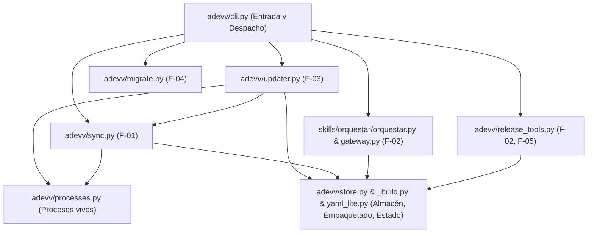

# Plan de Plataforma · Adevv: instalación, actualización y distribución

> Arquitectura y stack mínimos para empaquetar, instalar, sincronizar y autoactualizar Adevv como herramienta global por máquina (`adevv`), cumpliendo [`requirements.md`](requirements.md), [`req_analysis.md`](req_analysis.md) y las funcionalidades [`F-01`](funcionalidades/F-01_instalacion_y_sincronizacion.md) a [`F-05`](funcionalidades/F-05_publicacion.md).

---

## 1. Necesidades que condicionan

| Necesidad | Valor (base o supuesto) | Por qué condiciona |
|---|---|---|
| **Tamaño y escala** | 1 usuario (el autor), 1 máquina principal (Windows 11; deseable no romper en Linux/macOS), ~12 proyectos locales (`requirements.md §2, §6`) | Descarta servidores propios, bases de datos, índices públicos (PyPI) y telemetría remota; todo el estado cabe en archivos JSON locales bajo `~/.adevv/` |
| **Bloqueo de ejecutables y archivos en uso en Windows** | En Windows (NTFS) un `.exe` o entorno en ejecución no puede reemplazarse in situ, y los procesos `gateway` son perpetuos y no aplazan la actualización (`RF-F03-07/08`, `DEC-03`, `CA-F03-05`) | Impide actualizar sobrescribiendo un único entorno compartido; exige almacenar versiones lado a lado (`~/.adevv/versions/<id>/`) y conmutar mediante un puntero atómico sin tocar los archivos de las versiones en marcha |
| **Ejecución síncrona con la versión recién actualizada** | Si una orden dispara una actualización, la acción de esa misma orden debe ejecutarse íntegra con la versión nueva (o íntegra con la anterior si falla) y emitir los avisos solo por `stderr` (`RF-F03-07`, `RF-F03-13`, `CA-F03-02`, `CA-F03-16`) | Descarta un actualizador desacoplado post-salida; el despachador de `adevv` debe comprobar e instalar antes de delegar la acción al código de la versión activa en el mismo árbol de procesos |
| **Tiempos y operación sin credenciales interactivas** | Consulta de versiones ≤ 5 s; descarga e instalación ≤ 180 s; reintento sin red ≥ 1 h; ventana entre comprobaciones contadas ≥ 24 h; prohibido abrir ventanas o prompts de credenciales (`RF-F03-03/07`, `SUP-06/07`, `PQ-03`) | La consulta al origen fijo (`github.com/nereodata/nereoskills`) debe resolverse en una sola operación Git (`git ls-remote --tags`) con `GIT_TERMINAL_PROMPT=0` y `GCM_INTERACTIVE=never`, reutilizando en silencio las credenciales guardadas en Git tanto si el repositorio es público como si pasa a privado |
| **Entorno real de la máquina** | Comprobado en disco: Python 3.12.10 (`pip` 25.0.1, sin `PyYAML`, sin `uv` ni `pipx` preinstalados), Git 2.55, Claude Code 2.1.302 (`~/.claude`), Codex CLI 0.163.0 (`~/.codex`) y Antigravity CLI 1.4.5 (`~/.gemini/config`) | El paquete no debe depender de librerías externas ni de backends de construcción que requieran internet en los tests: librería estándar de Python ≥ 3.11 (con parser YAML ligero propio y uso de `PyYAML` si está disponible) y backend PEP 517 en el propio árbol |
| **Carpetas globales de los tres arneses (`PQ-01`, `RF-F01-03`)** | Confirmado empíricamente sobre las versiones instaladas: Claude Code lee `~/.claude/{skills,agents}`; Codex 0.163.0 lee `~/.codex/{skills,agents}` (`$CODEX_HOME`); Antigravity 1.4.5 documenta en su skill interna `agy-customizations` y lee en `agy.EXE` `~/.gemini/config/{skills,workflows}` (no `~/.gemini/antigravity`) | Fija el mapa de destinos confirmados (`DESTINOS`) para cumplir `CE-1` en los tres arneses sin tocar los proyectos, manteniendo soporte declarativo para destinos sin carpetas confirmadas (`CA-F01-02`) |
| **Integridad ante cortes y seguridad de rutas** | Escritura atómica de estado/registros (`§6`), prohibición de seguir enlaces o salir del destino (`RF-F01-05`, `RF-F04-02`) y paquete por lista blanca estricta desde el commit etiquetado (`RF-F05-01/03`) | Todas las escrituras de estado usan archivo temporal en el mismo directorio + `os.replace`; el sincronizador y el migrador inspeccionan `lstat` / atributos reparse sin seguir enlaces |

---

## 2. Opciones y decisión

### Opción 1 · Entorno único gestionado por `uv tool install` / `pipx` in situ (descartada)
- **Cómo funciona:** `adevv` vive en un único entorno virtual (`~/.local/share/uv/tools/adevv` o `pipx/venvs/adevv`); actualizar ejecuta `uv tool install --force git+https://...@vA.B.C` sobre ese mismo directorio.
- **Por qué se descarta:**
  1. En Windows, mientras `adevv` está ejecutándose, su propio lanzador (`adevv.exe`) está bloqueado por el sistema operativo, por lo que una actualización lanzada desde dentro de `adevv` falla al intentar sobrescribirlo.
  2. Si hay un `gateway` en marcha (`adevv telegram`), que por `DEC-03` y `RF-F03-08` no aplaza la actualización, sobrescribir el único entorno modifica o borra los archivos de la versión que el gateway sigue usando (`CA-F03-05`).
  3. Si la instalación falla a mitad o la versión del paquete no coincide con la etiqueta (`CA-F03-08`, `CA-F03-09`), el entorno anterior queda corrupto o pisado.

### Opción 2 · Entorno único con proceso actualizador desacoplado al salir (descartada)
- **Cómo funciona:** cuando `adevv` detecta una versión nueva, lanza un proceso auxiliar en segundo plano que espera a que el proceso `adevv` actual termine, actualiza el entorno y vuelve a lanzar la orden.
- **Por qué se descarta:**
  1. Rompe la ejecución síncrona y la captura de salida (`RF-F03-07`, `CA-F03-02`, `CA-F03-16`): cuando el usuario o una skill ejecuta `adevv orquestar --estado`, el proceso principal no puede terminar antes de actualizar y aun así devolver al llamador por `stdout` el estado calculado con la versión nueva y su código de retorno.
  2. Con `adevv orquestar --fondo`, coordinar que el bucle no arranque hasta que termine el actualizador desacoplado introduce condiciones de carrera, y sigue incumpliendo `RF-F03-08` mientras haya un gateway perpetuo abierto.

### Opción 3 · Despachador estable + almacén de versiones lado a lado en `~/.adevv/versions/` (elegida)
- **Cómo funciona:**
  1. Adevv se empaqueta como paquete Python estándar (`pyproject.toml`, comando `adevv`) sin dependencias externas fuera de la librería estándar de Python ≥ 3.11.
  2. El directorio de usuario `~/.adevv/` (o `$ADEVV_HOME` en pruebas) mantiene cada versión instalada en una carpeta inmutable `~/.adevv/versions/<id>/` (con `adevv/`, `skills/`, `agents/`, `workflows/` y `meta.json`) y un puntero activo `~/.adevv/active.json` actualizado de forma atómica (`tempfile` + `os.replace`).
  3. Cuando arranca cualquier orden `adevv`, el punto de entrada actúa como despachador:
     - Inicializa `~/.adevv/versions/<actual>/` y `~/.adevv/active.json` si es la primera ejecución tras instalar el paquete base, y desde ese momento delega la ejecución en los módulos de la versión apuntada por `~/.adevv/active.json`.
     - Evalúa la tabla de actualización (`requirements.md §4`, `F-03`) y la coherencia de destinos (`RF-F01-11`).
     - Si corresponde instalar una versión publicada `A.B.C`, descarga el commit de la etiqueta anotada `vA.B.C` en una carpeta temporal `~/.adevv/versions/.staging-A.B.C-<pid>/`, materializa únicamente los archivos de la lista blanca (`RF-F05-01`), comprueba que la versión declarada del paquete en ese commit es `A.B.C` (`RF-F03-07`, `CA-F03-09`), renombra a `~/.adevv/versions/A.B.C/`, conmuta atómicamente `~/.adevv/active.json` y ejecuta la sincronización de destinos (`F-01`) cargando ya el `adevv/sync.py` (y el mapa `DESTINOS`) de la nueva versión activa `~/.adevv/versions/A.B.C/`.
     - Despacha la acción solicitada (`orquestar`, `telegram`, `release`, `instalar`, `actualizar`, `migrar`, `--version`) cargando y ejecutando los módulos desde la ruta de la versión activa `~/.adevv/versions/<V>/` (y pasando `ADEVV_BOOTSTRAPPED=1` a los subprocesos hijos como `--fondo` para no repetir la comprobación, `SUP-05`).
     - Al finalizar una actualización exitosa, limpia de `~/.adevv/versions/` las versiones antiguas que no sean la activa ni estén siendo usadas por ningún proceso de Adevv en marcha.
- **Por qué se elige:**
  - Cumple simultáneamente `RF-F03-07` y `RF-F03-08` en Windows: ningún `.exe` ni archivo `.py`/`.md` en uso por la propia orden o por un `gateway` en marcha se modifica jamás durante la actualización (`CA-F03-05`).
  - Si la descarga, la construcción o la validación de `A.B.C` falla (`CA-F03-08`, `CA-F03-09`), basta con borrar la carpeta `.staging` y mantener `active.json` intacto: la versión anterior ejecuta la acción sin haber sufrido ningún cambio.
  - La orden de primera instalación del README (`RF-F01-01`, `CA-F01-01`) funciona en un solo paso (`pip install --user git+https://github.com/nereodata/nereoskills.git@v0.1.0 && adevv instalar`, o con `uv tool install`): aunque la orden instale inicialmente la `0.1.0`, `adevv instalar` descarga la `0.1.1` en `~/.adevv/versions/0.1.1/`, conmuta `active.json` sin chocar con el `adevv.exe` abierto en Windows y deja sincronizada la `0.1.1`.
- **Qué haría cambiar de opinión:** que el producto dejara de ser para un único usuario o requiriese instalar extensiones nativas C compiladas por versión (en cuyo caso cada versión en `~/.adevv/versions/<id>/` necesitaría su propio `.venv` completo en lugar de un árbol de paquete Python puro).

---

## 3. Stack

| Capa | Elección | Necesidad que cubre |
|---|---|---|
| **Lenguaje y runtime** | Python ≥ 3.11 (librería estándar: `tomllib`, `json`, `hashlib`, `urllib.request`, `subprocess`, `shutil`, `zipfile`, `tempfile`, `unicodedata`, `pathlib`) | El motor (`orquestar.py`), el gateway (`gateway.py`) y los scripts de `release` ya están en Python; Python 3.12 está instalado en la máquina y `tomllib` (3.11+) lee `pyproject.toml` y `agents/codex/*.toml` sin paquetes externos |
| **Empaquetado (PEP 517 / PEP 621)** | `pyproject.toml` en la raíz con backend PEP 517 ligero en el propio árbol (`adevv._build`) y lista blanca declarativa | Permite construir e instalar el paquete (`pip install`, `uv tool install`) y ejecutar la prueba de lista blanca (`RF-F05-01`, `RF-F05-03`) 100 % en local y sin red ni dependencias de construcción externas |
| **Lectura/escritura de YAML** | Módulo interno `adevv/yaml_lite.py` (con delegación a `PyYAML` si está instalado) | Elimina el fallo cuando el Python del PATH no tiene `PyYAML` instalado (`requirements.md §6`, `RF-F02-03`), cubriendo `task_config.yaml` y el frontmatter Markdown del backlog |
| **Transporte y consulta de versiones** | Git CLI (`git ls-remote --tags`, `git fetch --depth 1`, `git archive`) invocado vía `subprocess` con `GIT_TERMINAL_PROMPT=0` y `GCM_INTERACTIVE=never` | Distingue etiquetas anotadas (`refs/tags/vX.Y.Z^{}`) de ligeras en ≤ 5 s (`RF-F03-02/03`, `CA-F03-07`), descarga el commit exacto consultado (`RF-F03-07`) y usa las credenciales guardadas en Git sin ventanas emergentes (`PQ-03`) |
| **Detección de procesos vivos** | `Get-CimInstance Win32_Process` (PowerShell) / `ctypes` en Windows; `ps` y `/proc` en Linux/macOS | Enumera procesos, padres y líneas de órdenes en ~0,5 s sin instalar `psutil` ni compiladores nativos (`requirements.md §6`, `DEC-02`) |
| **Persistencia de estado local** | Archivos JSON bajo `~/.adevv/` (`ADEVV_HOME`) con escritura atómica (`tempfile` + `os.replace`) | Guarda configuración, estado de actualización, versión activa y registros de sincronización con huellas SHA-256 sin corrupción ante cortes (`requirements.md §6`, `RF-F01-05`, `RF-F03-04`) |
| **Pruebas** | `unittest` + `tempfile` + `unittest.mock` (`python -m unittest discover -s tests`) | Ya es el runner configurado en `task_config.yaml` (`validation.command`); no requiere dependencias externas |

---

## 4. Estructura del código y reglas de capas

### Estructura en el repositorio fuente y en el paquete distribuible

```text
Adevv/
├── pyproject.toml                  # Manifiesto PEP 621 (name="adevv", version="X.Y.Z", script adevv = "adevv.cli:main")
├── adevv/                          # Código del paquete distribuible
│   ├── __init__.py                 # __version__, constantes del origen fijo y lista blanca
│   ├── _build.py                   # Backend PEP 517 in-tree y constructor del paquete filtrado por lista blanca (F-05)
│   ├── cli.py                      # Punto de entrada `adevv`, secuencia de arranque y despacho a la versión activa
│   ├── store.py                    # Almacén ~/.adevv/ (active.json, config.json, update_state.json, sync/*.json, versions/)
│   ├── updater.py                  # Tabla de 9 resultados (§4), consulta git ls-remote ≤5s, instalación lado a lado ≤180s (F-03)
│   ├── sync.py                     # Sincronización de destinos, resolución de rutas, registro SHA-256 y conflictos (F-01)
│   ├── processes.py                # Detección y clasificación de procesos de Adevv en marcha: bucle | gateway | otro (F-03)
│   ├── migrate.py                  # Diagnóstico de solo lectura `adevv migrar` (F-04)
│   ├── release_tools.py            # Subórdenes `adevv release manifiestos|completitud|changelog` y validación RF-F05-05 (F-02, F-05)
│   └── yaml_lite.py                # Lectura/escritura de task_config.yaml y frontmatter (usa PyYAML si existe, stdlib si no)
├── skills/                         # Skills distribuibles (incluye orquestar/orquestar.py, telegram_gateway/gateway.py, release/scripts/)
├── agents/                         # Agentes (.md) y adaptadores de Codex (agents/codex/*.toml)
├── workflows/                      # Workflows para Antigravity (*.md)
├── docs/                           # Exclusivo del repo de Adevv (excluido del paquete por lista blanca)
└── tests/                          # Suite de pruebas (excluida del paquete por lista blanca)
```

### Estructura del almacén de usuario (`~/.adevv/` o `$ADEVV_HOME`)

```text
~/.adevv/
├── active.json                     # {"version": "0.2.0", "id": "0.2.0", "origen": "publicada", "commit": "<sha>", "fecha": "..."}
├── config.json                     # {"auto_update": true, "disabled_targets": []}
├── update_state.json               # Fechas y versiones de la tabla de §4 (last_checked_at, deferred_version, failed_version, etc.)
├── sync/
│   ├── claude.json                 # {"version": "0.2.0", "files": {"skills/orquestar/SKILL.md": "<sha256>", ...}}
│   ├── codex.json
│   └── agy.json
└── versions/
    └── 0.2.0/                      # Copia inmutable de la versión (adevv/, skills/, agents/, workflows/, meta.json)
```

### Destinos confirmados por arnés (`DESTINOS` en `adevv/sync.py`)

| Clave | Nombre en UI | Carpeta base | Carpetas confirmadas y contenido escrito |
|---|---|---|---|
| `claude` | `Claude Code` | `~/.claude` | `skills/`: `skills/<n>/**` (sin `scripts/`, `*.py` ni `__pycache__`). `agents/`: `agents/<rol>.md` |
| `codex` | `Codex` | `~/.codex` (o `$CODEX_HOME`) | `skills/`: `skills/<n>/**` (sin código). `agents/`: `agents/codex/<rol>.toml` con las rutas de agente y skills resueltas a rutas absolutas de la versión instalada (`~/.adevv/versions/<V>/...`) |
| `agy` | `Antigravity` | `~/.gemini/config` | `skills/`: `skills/<n>/**` (sin código). `workflows/`: `workflows/<n>.md` con la ruta a `SKILL.md` resuelta a la ruta absoluta instalada (`~/.adevv/versions/<V>/skills/<n>/SKILL.md`) |

Si un destino en `DESTINOS` tiene su diccionario de carpetas confirmadas vacío (`{}`), cuando existe su carpeta base se reporta como `NO_DETECTADO` con el texto `<Arnés>: sin confirmar` y no se escribe nada (`RF-F01-03`, `CA-F01-02`).

### Reglas de capas y dependencias (en un solo sentido)



1. **Separación de E/S y decisión:** la evaluación de la tabla de actualización (`updater.evaluar_tabla`) y el cálculo de acciones de sincronización (`sync.planificar_sincronizacion`) reciben el estado y el reloj (`ahora`) por parámetro y devuelven estructuras de datos puras antes de tocar red o disco.
2. **Prohibición de dependencias inversas:** `store.py`, `processes.py`, `yaml_lite.py` y `_build.py` no importan `cli.py`, `updater.py`, `sync.py` ni `orquestar.py`.
3. **Unicidad de los motores existentes (`NO-04`):** `skills/orquestar/orquestar.py`, `skills/telegram_gateway/gateway.py` y `skills/release/scripts/*.py` siguen siendo los módulos que implementan el bucle, el gateway y las validaciones de release; `adevv/cli.py` y `adevv/release_tools.py` los invocan desde la versión activa sin duplicar su lógica.
4. **Cero rutas relativas al submódulo o hacia afuera en instrucciones (`RF-F01-04`, `CA-F01-03`, `RF-F02-05`):** ningún archivo en `skills/**` (salvo código `.py`), `agents/**`, `workflows/**`, `templates/**` o destinos sincronizados puede contener `.agents/`, `python .../*.py`, `skills/<nombre>/scripts` ni rutas relativas que empiecen por `../`.

---

## 5. Estrategia de pruebas

Comando único de validación (`task_config.yaml`): `python -m unittest discover -s tests`.

| Nivel | Qué verifica | Cómo se aísla |
|---|---|---|
| **Unitarias de lógica pura** (`tests/test_updater.py`, `tests/test_sync.py`, `tests/test_migrate.py`) | Tabla de 9 resultados y ventana de 24 h / 1 h / 7 días (`E1`–`E13`, `CA-F03-01`..`16`), precedencia de estados de destino (`NO_DETECTADO`, `DESACTIVADO`, `DESFASADO`, `INCOMPLETO`, `SINCRONIZADO`), adopción sin registro (`CA-F01-09`), conflictos y `--forzar` (`CA-F01-04/05`), guarda contra traversal (`CA-F01-07`), borrado no recursivo (`CA-F01-08`), prefijos de proyecto nuevo (`MIA`, `PRJ`, `NAN`, `CA-F02-08/09`), diagnóstico y recuentos de `migrar` (`CA-F04-01`..`05`) | Reloj inyectable (`now`), `tempfile.TemporaryDirectory()` como `ADEVV_HOME` y como carpetas de arneses/proyectos |
| **Integración con repositorios Git locales** (`tests/test_install_and_release.py`) | Flujo completo de instalación y actualización (`CA-F01-01`, `CA-F03-02`, `CA-F03-07/08/09/12/14`), etiquetas anotadas frente a ligeras y pre-releases (`CA-F03-07`), bloqueo de publicación si la versión del paquete no coincide o la etiqueta ya existe en el remoto (`CA-F05-03/04/05`) | Repositorio Git bare local (`file://` o ruta local) inyectado mediante `ADEVV_ORIGIN_URL` en pruebas, sin tocar `github.com` |
| **Inspección estática y de paquete construido** (`tests/test_package_and_instructions.py`) | Construcción real del paquete y verificación contra la lista blanca (`RF-F05-01/03`, `CA-F05-01`), fallo ante archivos prohibidos versionados como `__pycache__/*.pyc` (`CA-F05-02`), y ausencia total de `.agents/`, `python .../*.py`, `skills/<n>/scripts` y rutas relativas `../` en todos los archivos de instrucciones distribuibles y en los destinos sincronizados (`CA-F01-03`, `CA-F02-04`) | Ejecuta `adevv._build` sobre un árbol temporal / repositorio y escanea el archivo construido y los destinos |
| **Procesos y recarga cooperativa** (`tests/test_updater.py`, `skills/orquestar/test_recarga.py`, `skills/telegram_gateway/test_recarga_gateway.py`) | `RF-F03-08`, `CA-F02-02`, `CA-F03-03/04/05/13`: instalación desde Git local con bucle simulado, cambio de puntero, copias y versiones en uso intactas; transferencia entre pasos y polling, conservación de estado y prioridad de parada | Hogares temporales, detección de procesos controlada y subprocesos de recarga con limpieza garantizada |

---

## 6. Pasos manuales que requieren a una persona

1. **Decidir la visibilidad del repositorio `nereodata/nereoskills` (`PQ-03`):** al revisar la `v0.1`, el autor decide si pasa el repositorio en GitHub a privado. La arquitectura funciona sin cambios en ambos casos (usa las credenciales ya almacenadas en Git con `GIT_TERMINAL_PROMPT=0` y `GCM_INTERACTIVE=never`).
2. **Publicar la `v0.1.0` al cerrar la versión (`/release`):** en el modelo de `/orquestar`, `/release` lo ejecuta el humano tras la revisión de versión (`skills/orquestar/SKILL.md` l. 116), creando y empujando la etiqueta anotada `v0.1.0` a `origin/main`.
3. **Ejecutar la migración manual de `Afinn` y del propio repositorio de `Adevv` (`DEC-04`, `RF-F04-06`, `CE-2`, `CE-5`):** guiado por `adevv migrar` y los pasos del `README.md` (parar bucle, quitar submódulo o junction `.agents` con `cmd /c rmdir .agents` sin seguirla, limpiar enlaces/adaptadores hasta que `adevv migrar` diga «Sin pendientes» y retirar `~/.adevv/congelado` cuando ningún proceso la use).

---

## 7. Decisiones (`DEC-Pxx`)

| ID | Decisión | Alternativa descartada | Motivo |
|---|---|---|---|
| **DEC-P01** | Almacén de versiones lado a lado en `~/.adevv/versions/<id>/` con puntero atómico `~/.adevv/active.json` y despacho desde `adevv/cli.py` en el mismo proceso | Sobrescribir un único entorno con `uv tool install --force` o lanzar un actualizador desacoplado tras salir | En Windows el ejecutable en uso está bloqueado; además, `RF-F03-08` y `CA-F03-05` exigen que los gateways en marcha sigan usando los archivos de su versión sin cambios y `RF-F03-07`/`CA-F03-02` exigen que la orden que dispara la actualización ejecute su acción con la versión nueva de forma síncrona |
| **DEC-P02** | Limpieza de versiones antiguas en `~/.adevv/versions/` al terminar cada actualización exitosa, borrando solo las carpetas que no sean la activa ni aparezcan en ningún proceso de Adevv en marcha | Borrar inmediatamente la versión anterior o no borrar nunca | Si hay un gateway en marcha usando la versión anterior (`CA-F03-05`), borrarla al instante rompería `RF-F03-08`; conservarla mientras esté en uso y borrarla en la siguiente actualización ocupa pocos KB y evita procesos huérfanos |
| **DEC-P03** | Cero dependencias externas obligatorias: Python ≥ 3.11 stdlib, parser YAML ligero en `adevv/yaml_lite.py` (que delega en `PyYAML` si está instalado) y backend PEP 517 propio en `adevv/_build.py` | Exigir `PyYAML` y `hatchling`/`setuptools` como dependencias externas | En la máquina Windows 11 del autor el Python del PATH no tiene `PyYAML`, `uv` ni `setuptools` instalados (`pip list` solo tiene `pip`); con stdlib el paquete se construye, instala y pasa toda la suite offline en segundos |
| **DEC-P04** | Carpetas globales confirmadas (`PQ-01`): Claude Code en `~/.claude/{skills,agents}`, Codex en `~/.codex/{skills,agents}` (`$CODEX_HOME`) y Antigravity en `~/.gemini/config/{skills,workflows}` (confirmado en `agy 1.4.5` y su skill integrada `agy-customizations`); el mapa `DESTINOS` soporta carpetas vacías para destinos sin confirmar (`CA-F01-02`) | Usar `~/.gemini/antigravity/skills` por suposición o dejar Antigravity sin confirmar en producción | `~/.gemini/antigravity` es estado interno de ejecución; `agy 1.4.5` documenta y lee `~/.gemini/config/{skills,workflows}` (que ya existe en esta máquina), lo que permite cumplir `CE-1` en los tres arneses y mantener el contrato de `CA-F01-02` cuando un destino no declara carpetas confirmadas |
| **DEC-P05** | Mantener en los destinos el nombre de carpeta de cada skill en `skills/<carpeta>/` y comprobar en `RF-F02-07`/`RF-F04-02` tanto el nombre de carpeta como el `name` del frontmatter (`telegram_gateway` y `telegram-gateway`) | Renombrar `skills/telegram_gateway/` en el destino a `telegram-gateway` | Conserva la compatibilidad con el prompt del motor (`{skills}/<nombre>/SKILL.md`), permite que `RF-F01-09` adopte copias previas idénticas procedentes del antiguo submódulo (`CA-F01-09`) y detecta cualquier ocultación por carpeta o por `name` (`RF-F02-07`) |
| **DEC-P06** | Consulta de versiones publicadas mediante `git ls-remote --tags <origen>` filtrando `refs/tags/vX.Y.Z^{}` con `GIT_TERMINAL_PROMPT=0`, `GCM_INTERACTIVE=never`, `GIT_ASKPASS=echo` y `timeout=5`, e instalación del commit consultado mediante `git fetch --depth 1` + extracción por lista blanca con `timeout=180` | API HTTP de GitHub o `uv tool upgrade` | `git ls-remote --tags` distingue etiquetas anotadas (`^{}`) de ligeras en una sola petición (`CA-F03-07`), funciona igual con repositorio público o privado usando las credenciales de Git sin preguntar (`PQ-03`, `RF-F03-03`) e instala exactamente el commit visto en la consulta (`RF-F03-07`) |
| **DEC-P07** | Detección de procesos de Adevv en marcha mediante enumeración del SO (`Get-CimInstance Win32_Process` en Windows / `ps` y `/proc` en POSIX) combinada con metadatos de ejecución `~/.adevv/runtime/<pid>.json` (validados siempre contra la línea de órdenes del PID vivo) y extracción de ruta para bucles previos a la migración | Confiar solo en `orquestar.pid` o añadir la dependencia binaria `psutil` | Cumple `DEC-02` (ignora PIDs reutilizados por otros programas y detecta bucles/gateways anteriores a la migración por `orquestar.py`/`gateway.py` en la línea de órdenes, `CA-F03-04`) y conoce siempre la carpeta de trabajo para los mensajes de UI (`bucle en C:\SW\Afinn`, `gateway en C:\SW\Adevv`) sin dependencias nativas |
| **DEC-P08** | Incluir `pyproject.toml` (`type: toml`, `key: project.version`) en `task_config.yaml::release.manifests` y añadir a `adevv release` la validación previa de etiqueta y versión del paquete (`RF-F05-05`, `RF-F05-07`) | Actualizar `pyproject.toml` a mano en cada release | `/start-version` y `adevv release manifiestos` ya leen `release.manifests` en `task_config.yaml`; declararlo allí alinea automáticamente `pyproject.toml` con `project.version` sin pasos manuales (`CA-F05-05`) |
| **DEC-P09** | Exponer el generador y consulta de métricas (`--metricas [FILTRO]` / `--metrics [FILTRO]` y `--csv [ruta.csv]`) y demás ampliaciones operativas de `v0.4` directamente en los motores de `skills/orquestar/` (`orquestar.py` / `metricas.py`) y `skills/telegram_gateway/` (`gateway.py`), permitiendo ubicar las pruebas unitarias del delta en `skills/<skill>/test_*.py` (además de `tests/`) | Registrar un subcomando raíz `adevv metrics` con `-v`/`--version` en `adevv/cli.py` o exigir modificaciones fuera de `skills/` | `adevv/cli.py` ya despacha `adevv orquestar <args>` y `adevv telegram <args>` íntegramente a `skills/` (regla 3 de capas, `NO-04`), su parser raíz captura `-v`/`--version` para mostrar la versión de Adevv, `adevv/processes.py` ya clasifica `gateway.py` como `"gateway"`, y `skills/*.py` es ignorado por `sync.py` en los arneses; así el contrato cumple las rutas autorizadas (`skills/`, `agents/`, `workflows/`) sin colisión de flags |
| **DEC-P10** | Implementar las ampliaciones operativas de `v0.5` (`T-ADV-0018` auto-recarga cooperativa entre ciclos al cambiar `~/.adevv/active.json`, `T-ADV-0019` firma de versión en Telegram y `T-ADV-0020` comando `/agentes` / `--agentes` con porcentaje de cuota) íntegramente en los motores `skills/orquestar/orquestar.py` y `skills/telegram_gateway/gateway.py` y verificarlas con pruebas unitarias en `skills/<skill>/test_*.py`, sin modificar `adevv/` ni `tests/features/` | Modificar `adevv/updater.py` para reiniciar procesos desde el instalador o sustituir el escenario `@CA-F03-05` en `tests/features/actualizacion_automatica.feature` | Concilia `DEC-P01`, `RF-F03-08` y `CA-F03-05` con `T-ADV-0018`: durante `adevv actualizar` (y mientras dura cualquier paso de `bucle()` o petición de `escuchar()`), `adevv/updater.py` instala la nueva versión lado a lado en `~/.adevv/versions/<nueva>/`, mantiene intacta `~/.adevv/versions/<anterior>/`, no mata procesos en marcha y conserva el mensaje de aviso y el comportamiento de `CA-F03-05` para procesos que corren versiones previas (`0.1.0`) o siguen en mitad de su operación; la recarga a la nueva versión activa ocurre de forma cooperativa e interna en `skills/telegram_gateway/gateway.py` (al inicio de la siguiente vuelta de polling en `escuchar()`) y en `skills/orquestar/orquestar.py` (al inicio de la siguiente iteración entre pasos en `bucle()`), respetando las rutas autorizadas (`skills/`, `agents/`, `workflows/`) |

### DEC-P13 · Instalación inmediata y copias globales diferidas (B-ADV-0009)
Se sustituye el aplazamiento de instalación de CE-3, RF-F03-06 y RF-F03-11. El almacén lado a lado (DEC-P01) permite instalar y conmutar incluso con bucles: no se reemplazan directorios existentes ni versiones en uso. La recarga cooperativa de DEC-P10 se conserva sin cambios. Los motores preparan los mandatos desde el almacén activo, por lo que la copia global no es requisito para continuar con la nueva versión.

La sincronización de destinos compartidos se difiere mientras exista cualquier bucle, en todos sus llamantes (actualización automática/dirigida, instalar y --forzar). La primera orden fuera de pasos y sin bucles la reintenta. Se elige esta opción conservadora frente a copiar entre pasos: el hueco de un proyecto no garantiza que otro proyecto esté entre pasos; sincronizarlos exigiría un protocolo global de barrera. Puede quedar pendiente indefinidamente si siempre hay bucles; no impide ni instalación ni recarga de mandatos del motor. Los gateways y consolas interactivas conservan la política previa de RF-F01-11. `aplazada` se acepta solo para migrar estado anterior, sin crear nuevos estados de instalación aplazada. El aviso distingue copias pendientes, recarga de motores desde v0.5 y reinicio manual de anteriores.
