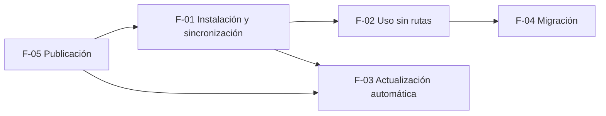

# Adevv: instalación, actualización y distribución

> **Empieza aquí.** Especificación funcional producida por `/ciclo-requisitos` (modo orquestado). Detalle por funcionalidad en [`funcionalidades/`](funcionalidades/); supuestos, preguntas y decisiones en [`req_analysis.md`](req_analysis.md); el trabajo del ciclo, en [`ciclo/`](ciclo/). Entrada de `/platform-plan` y `/work-plan`.

## 1. Petición original

Texto íntegro del `requirements.md` de entrada (copia en [`ciclo/requirements_original.md`](ciclo/requirements_original.md)):

> Hoy Adevv se incorpora a cada proyecto como submódulo de git (`.agents/`). Quiero sustituirlo por un sistema de empaquetado e instalación de Adevv con despliegue y actualización automáticos, de forma que el propio Adevv pueda desarrollarse como un proyecto Adevv (con su backlog) sin que eso afecte a los proyectos que lo usan.

El resto del documento original se conserva literal (las anotaciones del ciclo van marcadas _(ciclo)_): encuadre, decisiones previas, no-objetivos y criterios de éxito en §2; entorno en §6.

## 2. Encuadre

**Problema.**
- Cada proyecto se trae el repositorio entero de Adevv como submódulo (tests, documentación y, a partir de ahora, su backlog) y hay que actualizarlo a mano en cada uno.
- Las rutas a las skills, los agentes y los scripts (`.agents/skills/orquestar/orquestar.py`, `.agents/agents/hades.md`…) dependen de dónde esté el submódulo en cada proyecto.
- Si `/orquestar` trabaja sobre el propio repositorio de Adevv, el bucle ejecuta el mismo motor y las mismas skills que está modificando.

**Objetivo.** Instalar Adevv una vez por máquina, usarlo en cualquier proyecto con cualquiera de los arneses que uso, y recibir versiones nuevas sin tocar cada proyecto.

**Peticiones explícitas** (literales; protegidas: se pueden simplificar, condicionar o reordenar, nunca eliminar sin preguntar):
1. Un sistema de empaquetado de skills y despliegue automático que sustituya al submódulo.
2. Que el propio Adevv sea un proyecto Adevv, con su backlog, sin que el backlog llegue a los proyectos que lo usan.
3. Que la herramienta busque actualizaciones al lanzarse y se actualice si es necesario.

**Tamaño del producto.** Herramienta interna: un único usuario (el autor), en su propia máquina, con una docena de proyectos. _(ciclo)_ Condiciona el detalle: sin multiusuario, sin soporte, mensajes en español, escenarios de camino feliz, errores y límites relevantes.

**Decisiones previas del usuario** (orientativas; `/platform-plan` puede afinarlas con motivo):
- Distribución preferida: paquete Python instalable como herramienta de línea de órdenes (p. ej. `uv tool install adevv` o `pipx`), con una orden `adevv`. El motor ya es Python.
- Órdenes previstas: instalar o sincronizar las skills, los agentes y los workflows donde los busca cada arnés; lanzar el orquestador y el gateway de Telegram sin rutas al submódulo; comprobar y aplicar actualizaciones.
- Actualización: solo desde versiones publicadas (nunca desde `main`); nunca con un bucle de `/orquestar` en marcha en ningún proyecto; si no hay red, sigue con la versión instalada; como mucho una comprobación al día; desactivable por configuración de usuario.
- En Windows, un ejecutable en uso no se puede sustituir: la actualización no puede reemplazar el proceso que la lanza.
- Las skills, preferiblemente instaladas en las rutas globales de cada arnés, para que una actualización no deje cambios sin commitear en los proyectos.
- Un plugin de Claude Code, como mucho, es un destino más de la sincronización, no el mecanismo principal (Codex y Antigravity no lo usan).

**Principios previos que cambian.**
- *Antes:* Adevv vive dentro de cada proyecto (`.agents/`, submódulo) y cada proyecto fija su versión con el puntero del submódulo. *Ahora:* Adevv vive una vez por máquina; todos los proyectos usan la versión instalada (una sola versión por máquina, ver `DEC-01`).
- *Antes:* las skills y agentes citan rutas relativas al proyecto (`.agents/...`). *Ahora:* nada de lo que se instala cita `.agents/`; los scripts se invocan por la orden `adevv` y las rutas a skills y agentes las resuelve la instalación (ver `F-02`).
- *Antes:* `branch_strategy.md §8` regula el submódulo. *Ahora:* esa sección se sustituye por los pasos de migración (`F-04`).

**No-objetivos.**
- NO-01: El script de arranque con la sesión de Windows que lanza los bots de Telegram configurados (versión posterior; se apoyará en la orden `adevv`).
- NO-02: Conversar con el arnés configurado desde Telegram con texto libre (versión posterior).
- NO-03: Distribuir Adevv a otros usuarios u organizaciones (soporte, documentación pública, registro de usuarios).
- NO-04: Rediseñar el bucle de `/orquestar` o las skills más allá de lo necesario para que funcionen instalados.
- NO-05: Varias versiones de Adevv instaladas a la vez, o fijar una versión distinta por proyecto (ver `DEC-01`).
- NO-06: Instalar o actualizar los propios arneses (`claude`, `codex`, `agy`); Adevv solo escribe en sus carpetas de skills, agentes y workflows.
- NO-07: Volver a una versión anterior de forma automática (la vuelta atrás es manual, con `adevv actualizar X.Y.Z`, y desactiva la actualización automática; ver `F-03`).
- NO-08: Órdenes `init`, `desinstalar`, autocompletado de la shell, plugin de Claude Code como destino y prefijos de nombre en las skills (ver `DEC-05`).
- NO-09: Migrar proyectos automáticamente (`adevv migrar` solo diagnostica; ver `DEC-04`).

**Criterios de éxito.**
- CE-1: En una máquina sin Adevv, se instala con una sola orden y un proyecto nuevo puede lanzar `/orquestar` con Claude Code, Codex y Antigravity sin submódulo.
  _Condicionado (ciclo):_ con Antigravity, a que lea alguna carpeta global confirmada (`PQ-01`); si no, su destino queda «sin confirmar» y CE-1 con Antigravity queda pendiente de la revisión de versión (`PQ-01`).
- CE-2: Un proyecto existente que usa el submódulo se migra siguiendo unos pasos documentados y su bucle sigue funcionando (incluidos los proyectos con adaptadores propios que citan rutas de `.agents/`).
- CE-3: Publicada una versión nueva de Adevv, la siguiente vez que se lanza la herramienta (sin bucles en marcha) queda actualizada sin intervención.
- CE-4: El backlog, los tests y la documentación interna de Adevv no aparecen en lo que se instala.
- CE-5: `/orquestar` puede ejecutarse sobre el repositorio de Adevv usando la versión instalada, sin que los cambios del árbol de trabajo afecten al bucle en curso.

**Presupuesto de complejidad.** Una sola versión (v0.1) de 3 a 5 tareas maestras. Sin olas adicionales. _(ciclo)_ Todas las funcionalidades son de la ola A.

## 3. Usuarios y recorridos

**Perfiles.**
- **Autor-operador:** usa Adevv en sus proyectos desde Claude Code, Codex o Antigravity; lanza `/orquestar`, mira el estado y revisa versiones. Técnico; no quiere tocar cada proyecto para actualizar.
- **Autor-desarrollador de Adevv:** la misma persona, trabajando en el repositorio de Adevv (con su backlog y su propio bucle) y publicando versiones.
- **El bucle** (actor automático): `orquestar.py` y los pasos que lanza, que invocan scripts y leen skills y agentes sin intervención humana.

**Recorridos.**
- **R0 · Primer uso en una máquina sin Adevv.** Ejecuta la orden de instalación del README (instala una versión publicada fija desde el origen y `adevv instalar`, que comprueba si hay una más nueva, la aplica y sincroniza los arneses detectados, diciendo cuáles) → si `adevv` no está en el PATH, el README da la orden que lo corrige → reinicia el arnés → en una carpeta con `requirements.md` (con git y `task_config.yaml`, o sin ninguno de los dos), `/orquestar` lanza el bucle desde Claude Code, Codex o Antigravity. **Tiempo hasta valor:** ≤ 10 min sin leer más que la sección de instalación del README.
- **R1 · Uso diario en un proyecto.** Desde el arnés, `/orquestar` (lanzar, estado, parar); el bucle invoca `adevv orquestar …` sin rutas del proyecto. Las revisiones de Hades y la verificación se lanzan con la misma orden.
- **R2 · Actualización automática.** El autor publica vX.Y.Z → en la siguiente orden `adevv` (sin bucles en marcha y sin comprobación contada en las últimas 24 h) se detecta y se aplica, se resincronizan los arneses y la acción de la orden corre ya con la versión nueva → un aviso de una línea dice de qué versión a qué versión. Si hay un bucle en marcha, se aplaza, lo dice una vez al día y se aplica en la primera orden sin bucles en marcha; un gateway abierto no la impide: sigue con su versión durante la instalación y la operación en curso (y hasta reiniciarse en versiones anteriores a `v0.5.0`, o hasta su auto-recarga cooperativa entre vueltas de polling desde `v0.5.0`) y el aviso pide reiniciarlo.
- **R3 · Migración de un proyecto con submódulo.** El autor para el bucle del proyecto → `adevv migrar` en la raíz informa de lo pendiente (submódulo, enlaces, `instructions`, copias de Adevv, skills locales y referencias a `.agents/` en archivos en uso, con archivo y línea) → sigue los pasos documentados → `adevv migrar` repetido dice «Sin pendientes» → relanza `/orquestar` y el bucle sigue donde iba.
- **R4 · Desarrollo y publicación de Adevv.** En el repositorio de Adevv, `/orquestar` corre con la versión instalada mientras el árbol cambia → al cerrar la versión, `/release` publica una versión con solo el contenido distribuible → R2 en todas partes.

## 4. Modelo de dominio

| Entidad | Campos | Quién los asigna |
|---|---|---|
| **Instalación** (una por máquina) | versión instalada (`X.Y.Z`, leída del propio paquete), tipo de origen (`publicada` \| `desarrollo`), commit instalado, fecha | La orden de instalación y cada actualización |
| **Versión publicada** | número `X.Y.Z`, etiqueta anotada `vX.Y.Z` en el origen fijo, commit | `/release` en el repositorio de Adevv (`F-05`) |
| **Contenido distribuible** | skills, agentes, adaptadores de cada arnés, workflows (los «archivos de instrucciones») y el código del paquete (motor `orquestar`, `gateway`, scripts de `release`) | Lista blanca del paquete (`F-05`) |
| **Destino** (uno por arnés: Claude Code, Codex, Antigravity) | carpetas globales confirmadas del arnés para skills, agentes y workflows; estado | `adevv instalar`; la configuración de usuario puede desactivarlo |
| **Registro de sincronización** | por destino: versión sincronizada y, por archivo escrito, ruta relativa y huella (hash) | `adevv instalar` |
| **Configuración de usuario** | actualización automática (sí por defecto), destinos desactivados | El autor; la vuelta atrás (`RF-F03-11`) desactiva la actualización automática y `adevv actualizar` la reactiva |
| **Estado de actualización** | última comprobación contada (fecha); último `SIN_RED` (fecha y causa); versión aplazada; versión fallida (y causa); fecha del último aviso de aplazamiento, del último aviso sin red y del último aviso de resincronización aplazada; último resultado `APLICADA`/`FALLIDA` con fecha | Cada orden `adevv` que comprueba |
| **Proceso de Adevv en marcha** | PID, tipo (`bucle` \| `gateway` \| `otro`), carpeta de trabajo si se conoce | Se calcula en cada comprobación; no se guarda |

**Estados de un destino** (precedencia: el primero que se cumple):

| Estado | Condición | En `adevv --version` |
|---|---|---|
| `NO_DETECTADO` | No existe la carpeta base del arnés, o la versión no tiene carpetas confirmadas para él. Adevv no crea nada | «<Arnés>: no detectado» / «sin confirmar» |
| `DESACTIVADO` | La configuración de usuario lo desactiva | «<Arnés>: desactivado» |
| `DESFASADO` | La versión sincronizada del registro ≠ la instalada (incluye la última sincronización interrumpida por un error, que no registra versión) | «<Arnés> X.Y.Z (pendiente de sincronizar)» |
| `INCOMPLETO` | Sincronizado con la versión instalada salvo conflictos (rutas ajenas u ocupadas, archivos de Adevv editados a mano) | «<Arnés> X.Y.Z (N conflictos)» |
| `SINCRONIZADO` | Todo el contenido escrito | «<Arnés> X.Y.Z» |

**Resultados de una comprobación de actualización.** La hace cada orden `adevv` al arrancar, antes de su acción. Precedencia: se aplica el primero que se cumple. Las filas «auto» no se aplican en `adevv actualizar` (comprobación forzada). En `adevv instalar` no se aplica la fila 4. `adevv actualizar X.Y.Z` no hace esta comprobación (`RF-F03-11`).

| # | Resultado | Condición | ¿Cuenta como comprobación del día? | Mensaje (UI, salida de errores) |
|---|---|---|---|---|
| 1 | `DESACTIVADA` (auto) | La configuración de usuario la desactiva | no | ninguno |
| 2 | `DENTRO_DE_ORQUESTACION` | La orden la lanza un paso de un bucle | no | ninguno |
| 3 | `DESARROLLO` (auto) | La instalación no viene de una versión publicada | no | ninguno (se ve en `adevv --version`) |
| 4 | `ESPERA` (auto) | Último `SIN_RED` hace < 1 h; o última comprobación contada hace < 24 h sin versión aplazada | no | ninguno |
| 5 | `SIN_RED` | No se pudo consultar el origen en ≤ 5 s (sin red, credenciales o error del origen), o la instalación de una versión nueva no pudo descargarla | no | auto: ninguno, salvo que la última comprobación contada tenga ≥ 7 días: «No se ha podido comprobar actualizaciones desde <fecha>: <causa>.» (como mucho 1 vez cada 24 h). Forzada y en `adevv instalar`: «No se pudo consultar <origen>: <causa>. Sigues con la X.Y.Z.» |
| 6 | `AL_DIA` | No hay versión nueva | sí | auto: ninguno. Forzada: «Adevv X.Y.Z está al día.» |
| 7 | `APLAZADA` | Hay versión nueva (consultada, o aplazada antes) y algún bucle en marcha | sí | «Adevv A.B.C disponible; se aplicará cuando no haya bucles en marcha: <lista>.» como mucho 1 vez cada 24 h (siempre en forzada) |
| 8 | `APLICADA` | Hay versión nueva, ningún bucle en marcha, y se instaló | sí | «Adevv actualizado de X.Y.Z a A.B.C. Reinicia las sesiones abiertas de los arneses para usar las skills nuevas.» + «Reinicia el gateway en <carpeta>.» por cada gateway en marcha |
| 9 | `FALLIDA` | Hay versión nueva, ningún bucle en marcha, y la instalación falló por otra causa, no terminó en ≤ 180 s, o la versión instalada no es A.B.C | sí | «No se pudo actualizar a A.B.C: <causa>. Sigues con la X.Y.Z. Reintenta con `adevv actualizar`.» |

Con una versión aplazada guardada, las comprobaciones automáticas siguientes no consultan la lista de versiones (`adevv actualizar` sí la consulta y aplica la mayor): solo miran si quedan bucles en marcha (fila 7 o 8/9); la instalación sí descarga, y sin red da `SIN_RED`. `APLICADA`, `FALLIDA` y la instalación de cualquier otra versión borran la versión aplazada.

**Definiciones.**
- *Versión más nueva:* comparación numérica de `X.Y.Z`, no de texto: `0.10.0 > 0.9.3`.
- *Versión publicada:* etiqueta anotada del origen fijo cuyo nombre encaja exactamente con `vX.Y.Z` (X, Y y Z enteros, sin sufijo). Que esté en `main` y que coincida con la versión del paquete lo garantiza la publicación (`RF-F05-05/06`) y se comprueba tras instalar (fila 9).
- *Versión nueva:* versión publicada mayor que la instalada; en comprobación automática, además mayor que la versión fallida, si la hay.
- *Hace < N h:* diferencia en horas entre ahora y la fecha guardada, estrictamente menor que N.
- *Proceso de Adevv en marcha:* proceso vivo, distinto de la propia orden y de sus procesos padre, que ejecuta código de cualquier versión instalada de Adevv, o cuya línea de órdenes ejecuta `orquestar.py` o `gateway.py` (bucles y gateways anteriores a la migración). Tipo `bucle` si ejecuta el orquestador sin `--estado`, `--verificar`, `--agente`, `--parar` ni `--aviso-prueba`; `gateway` si ejecuta el gateway; `otro` en el resto. **Solo los de tipo `bucle` aplazan** una actualización o una resincronización; los demás siguen con la versión con la que arrancaron durante la instalación y la operación en curso (`RF-F03-08`, `DEC-P10`).
- *Paso de un bucle:* proceso con la variable de entorno `ORQUESTAR_PASO` definida (la pone el bucle a cada paso).
- *Repositorio fuente de Adevv:* raíz de un repositorio con `pyproject.toml` cuyo `project.name` es `adevv`.
- *Instalación de desarrollo:* instalada desde algo que no es una versión publicada (el árbol de trabajo, una rama, un commit). Es una copia del origen en el momento de instalar, nunca un enlace al árbol de trabajo.

**Glosario interno → UI.** Los nombres de resultados y estados (`APLICADA`, `INCOMPLETO`…) solo aparecen en registros; al usuario se le muestran los mensajes en español. Los destinos se nombran por el arnés: «Claude Code», «Codex», «Antigravity». Los procesos, por tipo y carpeta: «bucle en C:\…\Afinn», «gateway en C:\…\Adevv», o «bucle (proceso 35528)» si no se conoce la carpeta.

## 5. Funcionalidades

| F | Nombre | Prioridad | Ola | Recorridos | Depende de | Enlace |
|---|---|---|---|---|---|---|
| F-05 | Publicación de versiones sin contenido interno | Must | A | R4 | — | [F-05](funcionalidades/F-05_publicacion.md) |
| F-01 | Instalación y sincronización con los arneses | Must | A | R0, R2 | F-05 | [F-01](funcionalidades/F-01_instalacion_y_sincronizacion.md) |
| F-02 | Adevv desde cualquier proyecto sin rutas | Must | A | R0, R1, R4 | F-01 | [F-02](funcionalidades/F-02_uso_sin_rutas.md) |
| F-03 | Actualización automática | Must | A | R2 | F-01, F-05 | [F-03](funcionalidades/F-03_actualizacion_automatica.md) |
| F-04 | Migración de proyectos con submódulo | Must | A | R3, R4 | F-02 | [F-04](funcionalidades/F-04_migracion.md) |

Cada `F-xx` es una tarea maestra para `/work-plan` (5, dentro del presupuesto de 3-5). Trazabilidad RF → CA en [`ciclo/trazabilidad.md`](ciclo/trazabilidad.md).

## 6. Entradas para /platform-plan

Restricciones y dependencias externas, sin decidir (regla 8 de `/ciclo-requisitos`):

- **Mecanismo de actualización en Windows** (`RF-F03-07/08`): el ejecutable y el entorno Python en uso no se pueden sustituir. Opciones vistas en el ciclo: versiones lado a lado con un lanzador estable y conmutación atómica; o un actualizador desacoplado que espera a que salga la orden, instala y vuelve a ejecutarla. Debe garantizar que la acción de la orden corre entera con una sola versión y que un bucle lanzado con `--fondo` no arranca hasta terminar la instalación.
- **Distribución:** preferencia del usuario por paquete Python con orden `adevv` (`uv tool install` o `pipx`). Comprobado: uv instala desde `git+https://…@<etiqueta>`; `uv tool upgrade` no mueve una etiqueta fijada, hay que reinstalar con la nueva ([docs de uv](https://docs.astral.sh/uv/guides/tools/)). Dependencia actual del motor: PyYAML (lo usa `suite()`); el Python del PATH puede no tenerla, de ahí `RF-F02-03`.
- **Origen fijo:** `github.com/nereodata/nereoskills` (remoto actual; el README cita `adevv.git`, ver `PQ-02`). Consulta de etiquetas sin credenciales interactivas (`GIT_TERMINAL_PROMPT=0` y equivalente del gestor de credenciales de Git en Windows); tiempo máximo 5 s.
- **Carpetas globales de cada arnés** (a confirmar con la versión instalada de cada uno):
  - Claude Code: `~/.claude/skills/<nombre>/SKILL.md` y `~/.claude/agents/<nombre>.md` (documentado). Contiene ya `~/.claude/skills/synced`, ajena.
  - Codex: la documentación oficial cita `~/.codex/skills`; algunas guías citan `~/.agents/skills` (ha cambiado entre versiones) ([OpenAI, Agent Skills](https://developers.openai.com/codex/skills)). Agentes: `agents/codex/*.toml`, hoy enlazados en `.codex/agents` del proyecto. Contiene `~/.codex/skills/.system`, de Codex.
  - Antigravity: solo fuentes no oficiales citan `~/.gemini/antigravity/skills`; los workflows se documentan por proyecto en `.agent/workflows`. En esta máquina existe `~/.gemini/antigravity` sin `skills/`. Ver `PQ-01`.
  - El nombre de la carpeta de cada skill en el destino frente a su `name` (`telegram_gateway` frente a `telegram-gateway`).
- **Detección de procesos de Adevv en marcha** en Windows (enumerar procesos y su línea de órdenes) sin dependencias pesadas.
- **Datos de usuario:** ubicación de la configuración, el estado de actualización y los registros de sincronización (fuera de los proyectos, por usuario).
- **Lista blanca del paquete** y construcción desde el commit etiquetado (`F-05`); prueba en `python -m unittest discover -s tests`.
- **Cambios en el motor** que pide `F-02`: `AGENTES`/`SKILL` y los prompts de `bucle()` y `agente()` con rutas absolutas y `adevv …`; `en_fondo()` con los argumentos originales; `gateway.py` carga el motor por ruta relativa.
- **Entorno** (literal del original): Sistema principal: Windows 11. Que no rompa en Linux o macOS es deseable, no obligatorio. Arneses en uso: Claude Code (`claude`), Codex (`codex`) y Antigravity (`agy`). Proyectos que hoy usan el submódulo: Adataxx, Adayy, Adoxx, Afinn y Aprexx (en `C:\Users\Iván Moreno\SW\`; ver `SUP-01`). Repositorio de Adevv: `github.com/nereodata/nereoskills` (rama `main`).
- **Gateways y versiones en uso** (`RF-F03-08`, `§4`): solo los bucles aplazan una actualización; un gateway o cualquier otro proceso de Adevv debe poder seguir con su versión mientras se instala la nueva. El mecanismo elegido debe permitirlo (p. ej. versiones lado a lado) y decidir cuándo se borra una versión antigua que ya no usa ningún proceso.
- **Restricciones técnicas retiradas de los RF en la revisión:** los archivos de estado (registro, configuración, estado de actualización) se escriben de forma que un corte deje la versión anterior completa o la nueva completa (antes `RF-F01-10`); el paquete se construye solo con los archivos versionados del commit publicado (antes `RF-F05-02`); la versión del paquete es un manifiesto de `release.manifests` en `task_config.yaml` (antes `RF-F05-04`).
- **Carpetas confirmadas por arnés** (`RF-F01-03`): cada versión declara para qué arneses y carpetas tiene destino confirmado; lo no confirmado no se escribe (`PQ-01`).
- **Visibilidad del repositorio de origen** (`PQ-03`): hoy es público (consulta sin credenciales); con el backlog de Adevv dentro, quedan publicados `docs/plan`, `docs/requirements` y `docs/review`, con nombres de proyectos y rutas personales. La consulta y la instalación deben funcionar sin preguntar credenciales tanto si es público como privado (con las ya guardadas en Git).
- **Python mínimo** y dependencias del paquete (PyYAML; `tomllib` requiere 3.11).
- **Ficheros a reescribir** por `RF-F02-05`: `agents/codex/*.toml`, `skills/orquestar/SKILL.md`, `skills/release/SKILL.md` y `templates/RELEASING.md`, `skills/seo-audit/SKILL.md`, `workflows/*.md`, `README.md`, `branch_strategy.md §8`.
