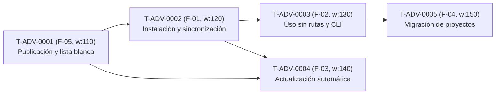

# Plan de Trabajo (`/work-plan`) · Adevv: instalación, actualización y distribución

> Estrategia de desarrollo y desglose en tareas del backlog para llevar a cabo [`requirements.md`](requirements.md), [`req_analysis.md`](req_analysis.md) y [`platform_plan.md`](platform_plan.md) (aprobado en [`platform_review.md`](platform_review.md)).

---

## 1. Estrategia de desarrollo (Delta, BDD/TDD y Stack)

- **Enfoque Delta sobre el repositorio actual:**
  - **Lo que ya existe y se conserva (`NO-04`):** el motor de orquestación (`skills/orquestar/orquestar.py`), el bot de Telegram (`skills/telegram_gateway/gateway.py`), los tres scripts de validación de versiones (`skills/release/scripts/*.py`), las 24 skills (`skills/**`), los 5 agentes (`agents/*.md`, `agents/codex/*.toml`), los workflows (`workflows/*.md`), `task_config.yaml` y la suite base en `tests/test_orquestar.py` y `tests/test_telegram_gateway.py`.
  - **El hueco real a construir:** el paquete instalable `adevv/` con backend PEP 517 propio y lista blanca (`_build.py`, `yaml_lite.py`, `release_tools.py`), el almacén versionado lado a lado (`store.py` bajo `~/.adevv/`), el sincronizador de destinos globales con registro SHA-256 (`sync.py`), el despachador CLI (`cli.py`) junto con la adaptación sin rutas del motor y de las instrucciones distribuibles, el actualizador automático con detección de procesos en Windows (`processes.py`, `updater.py`) y el diagnosticador de migración (`migrate.py` + guía en `README.md` y `branch_strategy.md`).
- **Tecnologías (fieles a `platform_plan.md §3`):** Python ≥ 3.11 usando exclusivamente la librería estándar (`tomllib`, `json`, `hashlib`, `subprocess`, `shutil`, `zipfile`, `tempfile`, `unicodedata`, `pathlib`), `adevv/yaml_lite.py` (con delegación a `PyYAML` si está instalado), Git CLI (`git ls-remote --tags`, `git fetch --depth 1`) sin prompts interactivos (`GIT_TERMINAL_PROMPT=0`, `GCM_INTERACTIVE=never`), enumeración de procesos del SO (`Get-CimInstance Win32_Process` en Windows / `ps` y `/proc` en POSIX) y `unittest`.
- **Filosofía BDD/TDD:** cada tarea maestra `T-ADV-XXXX` comienza en `/task-dev` (Subfase A) generando sus escenarios `.feature` en español a partir de los criterios `CA-M-n` y los `@CA-Fxx-nn` de origen, seguidos del diseño técnico de la tarea y las pruebas en rojo antes de implementar el código de producción.

---

## 2. Bloques funcionales, versión y orden de ejecución (`v0.1`)

Siguiendo el presupuesto de complejidad de `requirements.md §2` y `DEC-10` (`req_analysis.md`), las 5 funcionalidades de la ola A conforman una única versión funcional **`v0.1`** (tareas con `version: "v0.1.0"`, rama `release/v0.1`), ya que juntas entregan de principio a fin el reemplazo del submódulo `.agents/` por la herramienta global autoactualizable `adevv`.

### Hitos internos de `v0.1`
1. **Hito 1 · Empaquetado limpio y publicación (`T-ADV-0001`):** `pyproject.toml`, `adevv/_build.py`, `adevv/yaml_lite.py` y `adevv/release_tools.py` operativos; el paquete se construye solo con la lista blanca y `/release` valida versión y etiqueta anotada inmutable.
2. **Hito 2 · Almacén local y sincronización en arneses (`T-ADV-0002`):** `adevv/store.py`, `adevv/sync.py` y `adevv instalar` / `adevv --version` operativos; skills, agentes y workflows quedan instalados con rutas absolutas y protegidos con registro SHA-256 en Claude Code, Codex y Antigravity.
3. **Hito 3 · Operación sin submódulo en cualquier proyecto (`T-ADV-0003`):** `adevv orquestar`, `adevv telegram` y `adevv release` despachan desde la versión activa; prompts sin rutas relativas, inicialización automática de proyectos nuevos, bloqueo ante ocultación local y cero referencias a `.agents/` en instrucciones distribuibles.
4. **Hito 4 · Autoactualización lado a lado en Windows (`T-ADV-0004`):** `adevv/processes.py` y `adevv/updater.py` evalúan la tabla de 9 resultados al arrancar cada orden `adevv`, aplazan solo ante bucles vivos, instalan en `~/.adevv/versions/<V>/` sin romper gateways en marcha y permiten `adevv actualizar [X.Y.Z]`.
5. **Hito 5 · Diagnóstico y guía de migración (`T-ADV-0005`):** `adevv migrar` diagnostica proyectos consumidores y el propio Adevv sin seguir enlaces ni modificar archivos; `README.md` y `branch_strategy.md §8` documentan los pasos seguros de migración.

---

## 3. Backlog registrado (`docs/plan/tasks/`)

Todas las tareas son maestras (sin descomposición en hijas, al no haber múltiples componentes en `task_config.yaml::levels.components`), con estado inicial `planned` y `depende_de` explícito sin ciclos ni referencias a versiones posteriores:

| ID | Título | Origen | Versión | Peso | `depende_de` | Desbloquea | Módulos principales y pruebas de triaje |
|---|---|---|---|---|---|---|---|
| [`T-ADV-0001`](../plan/tasks/T-ADV-0001-publicacion-sin-contenido-interno.md) | Publicación de versiones sin contenido interno | `F-05` (`CA-F05-01`..`05`) | `v0.1.0` | `110` | `[]` | 4 (`0002`, `0003`, `0004`, `0005`) | `pyproject.toml`, `task_config.yaml`, `adevv/__init__.py`, `adevv/yaml_lite.py`, `adevv/_build.py`, `adevv/release_tools.py` · `tests/test_package_and_instructions.py`, `tests/test_install_and_release.py` |
| [`T-ADV-0002`](../plan/tasks/T-ADV-0002-instalacion-y-sincronizacion-arneses.md) | Instalación y sincronización con los arneses | `F-01` (`CA-F01-01`..`13`) | `v0.1.0` | `120` | `[T-ADV-0001]` | 3 (`0003`, `0004`, `0005`) | `adevv/store.py`, `adevv/sync.py`, `adevv/cli.py`, `README.md` · `tests/test_sync.py`, `tests/test_install_and_release.py` |
| [`T-ADV-0003`](../plan/tasks/T-ADV-0003-uso-desde-cualquier-proyecto-sin-rutas.md) | Adevv desde cualquier proyecto sin rutas | `F-02` (`CA-F02-01`..`10`) | `v0.1.0` | `130` | `[T-ADV-0002]` | 1 (`0005`) | `adevv/cli.py`, `skills/orquestar/orquestar.py`, `skills/telegram_gateway/gateway.py`, `skills/**`, `agents/codex/*.toml`, `workflows/*.md`, `skills/release/templates/RELEASING.md` · `tests/test_orquestar.py`, `tests/test_package_and_instructions.py` |
| [`T-ADV-0004`](../plan/tasks/T-ADV-0004-actualizacion-automatica.md) | Actualización automática de versiones publicadas | `F-03` (`CA-F03-01`..`16`) | `v0.1.0` | `140` | `[T-ADV-0001, T-ADV-0002]` | 0 | `adevv/processes.py`, `adevv/updater.py`, `adevv/cli.py` · `tests/test_updater.py`, `tests/test_windows_processes.py`, `tests/test_install_and_release.py` |
| [`T-ADV-0005`](../plan/tasks/T-ADV-0005-migracion-proyectos-submodulo.md) | Migración de proyectos con submódulo | `F-04` (`CA-F04-01`..`05`, `RF-F04-06`) | `v0.1.0` | `150` | `[T-ADV-0003]` | 0 | `adevv/migrate.py`, `adevv/cli.py`, `README.md`, `branch_strategy.md` · `tests/test_migrate.py` |

---

## 4. Estrategia de Integración Continua y Verificación

1. **Verificación acotada por tarea (`--verificar`):** durante `/task-dev` y las revisiones de Hades (`/review-code`), cada tarea ejecuta con `python skills/orquestar/orquestar.py --verificar "<comando>"` únicamente los módulos de prueba afectados por su triaje (p. ej. `python -m unittest tests/test_sync.py`), reutilizando la evidencia sobre el mismo árbol de trabajo cuando ya está en verde.
2. **Aislamiento de pruebas sin red ni efectos colaterales:** todas las pruebas inyectan `ADEVV_HOME` y carpetas de arneses/proyectos sobre `tempfile.TemporaryDirectory()`, reloj controlado (`now`) y repositorios Git `bare` locales (`ADEVV_ORIGIN_URL`), sin tocar `~/.adevv/`, `~/.claude/`, `~/.codex/`, `~/.gemini/` ni `github.com`.
3. **Suite completa al cierre de versión:** cuando las 5 tareas de `release/v0.1` están completadas y revisadas por Hades, el bucle ejecuta una sola vez la suite completa (`python -m unittest discover -s tests`) antes de `revisar-version` y de parar para la revisión humana.

---

## 5. Decisiones tomadas sin preguntar (`DEC-Wxx`)

| ID | Decisión | Alternativa descartada | Motivo |
|---|---|---|---|
| **DEC-W01** | Agrupar las 5 tareas maestras en una única versión `v0.1` (`version: "v0.1.0"`, `status: planned`) | Dividir en `v0.1` (instalación manual) y `v0.2` (autoactualización y migración) | Respeta el presupuesto explícito de `requirements.md §2` («Una sola versión (v0.1) de 3 a 5 tareas maestras. Sin olas adicionales») y entrega los 5 criterios de éxito (`CE-1`..`CE-5`) en un único cierre de versión |
| **DEC-W02** | Mantener las 5 tareas como tareas maestras atómicas sin descomponer en tareas hijas | Crear tareas hijas por submódulo interno de `adevv/` | `task_config.yaml` define un único nivel (`components: []`) y cada `F-xx` representa exactamente una capacidad con valor propio para el usuario percibida de extremo a extremo (`/task-add`) |
| **DEC-W03** | Asignar pesos ascendentes `110, 120, 130, 140, 150` alineados con el orden topológico de `depende_de` (`F-05 → F-01 → F-02 → F-03 → F-04`) | Numerar las tareas por el número nominal `F-01`..`F-05` con pesos `110`..`150` sin alinear con el grafo | Ordenar IDs y pesos según el orden de desbloqueo (`T-ADV-0001` primero porque `F-05` no tiene dependencias y desbloquea las demás; `T-ADV-0003` con peso `130` antes de `T-ADV-0004` con peso `140` porque `F-02` desbloquea `F-04`) hace coincidir la selección del orquestador (mayor desbloqueo y, a igualdad, menor `weight`) con la numeración secuencial del backlog |
| **DEC-W04** | Declarar `depende_de` directamente en el frontmatter de las 5 tareas maestras al crearlas en `work-plan` | Dejar `depende_de` vacío para que el bucle ejecute un paso adicional `calcular-dependencias` | La tabla de `/orquestar` para `work-plan` define «Hecho cuando: `work_plan.md` y tareas con versión y `depende_de` en el backlog», ahorrando un paso completo del bucle |
